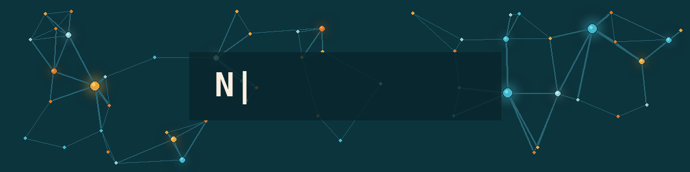
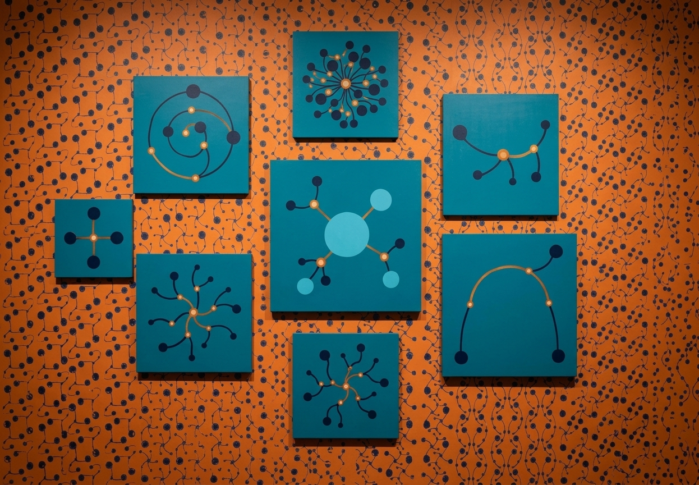

[](https://github.com/Asorky)




*Last manually updated:* `2026-10-13` <!-- TODO: automate this -->

<!--
**Asorky/Asorky** is a ✨ _special_ ✨ repository because its `README.md` (this file) appears on your GitHub profile.
-->

## :book: About Me
- 🖥 AI Engineer and physicist — production-oriented LLM systems, RAG, and agentic AI
- 🎓 Master's in AI from Universidad de los Andes · 5 years of experience in data science and analytics
- 🧪 Background in Complex Network Science for system modeling, and in designing knowledge ontologies
- 🏫 Designer and instructor of university-level AI and data science courses
- 🎧 btw I also DJ — *"DJ y coder"*

## ⬆ What I'm up to
- 🔨 I'm currently...
```yaml
- Conversational Data Access: SQL and Slack Bots 
- Building agentic AI systems and RAG pipelines (document intelligence: OCR + LLM extraction)
- Local-First Agentic Workflow Ecosystem 
- CRM and Operations Platforms
- Looking for fun Complex Networks and AI applications... 
```
- 🌱 I'm currently learning...
  - Agentic AI patterns and Model Context Protocol (MCP) in depth
- 👯 I'm looking to collaborate on...
  - RAG / document intelligence tooling, agentic systems, MCP servers
  - Algorithmic trading
  - Complex Network and GNN modeling
  - AI applications to music!
- 💬 Ask me about...
  - LLM applications, RAG, agents, MCP, data pipelines, Complex Networks
- 😄 Pronouns: he/him

## 🛠️ Tech Stack

**Languages:** Python · SQL · DAX

**LLM & Agent Stack:**

   

**ML Frameworks:**

   

**Data & Infrastructure:**

      

## 🔔 My Latest GitHub Metrics
![Metrics](https://metrics.lecoq.io/Asorky?template=classic&base.indepth=true&repositories.forks=true&languages=1&stargazers=1&stars=1&people=1&notable=1&traffic=1&gists=1&base=header%2C%20activity%2C%20community%2C%20repositories%2C%20metadata&base.indepth=true&base.hireable=false&base.skip=false&languages=false&languages.limit=8&languages.threshold=0%25&languages.other=true&languages.colors=github&languages.sections=most-used&languages.indepth=true&languages.analysis.timeout=15&languages.analysis.timeout.repositories=7.5&languages.categories=markup%2C%20programming&languages.recent.categories=markup%2C%20programming&languages.recent.load=300&languages.recent.days=14&stargazers=false&stargazers.days=14&stargazers.charts=true&stargazers.charts.type=classic&stargazers.worldmap=false&stargazers.worldmap.sample=0&stars=false&stars.limit=4&people=false&people.limit=24&people.identicons=false&people.identicons.hide=false&people.size=28&people.types=followers%2C%20following&people.shuffle=false&notable=false&notable.from=organization&notable.repositories=false&notable.indepth=false&notable.types=commit&notable.self=false&traffic=false&gists=false&config.timezone=Europe%2FMadrid)

## 🔔 My Latest GitHub Activity
<!--START_SECTION:activity-->
<!-- This section auto-fills once you add the jamesgeorge007/github-activity-readme Action below -->
<!--END_SECTION:activity-->

## 📫 How to reach me
You can reach me at the email in my GitHub profile, or on LinkedIn.

[](www.linkedin.com/in/nicolas-castillo-ak)
[](https://github.com/AsorKy)
